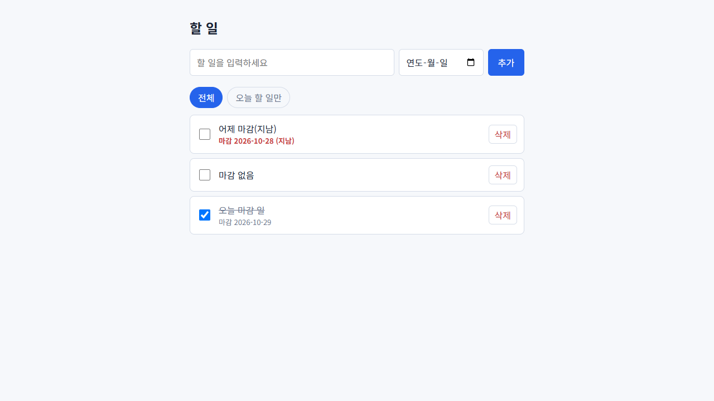
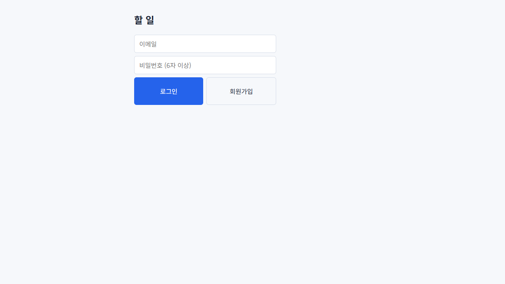
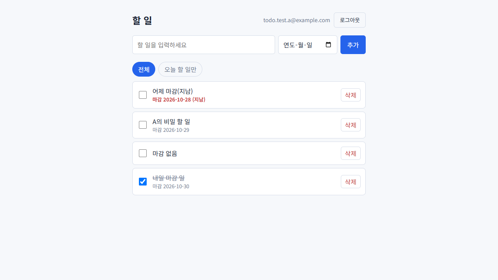
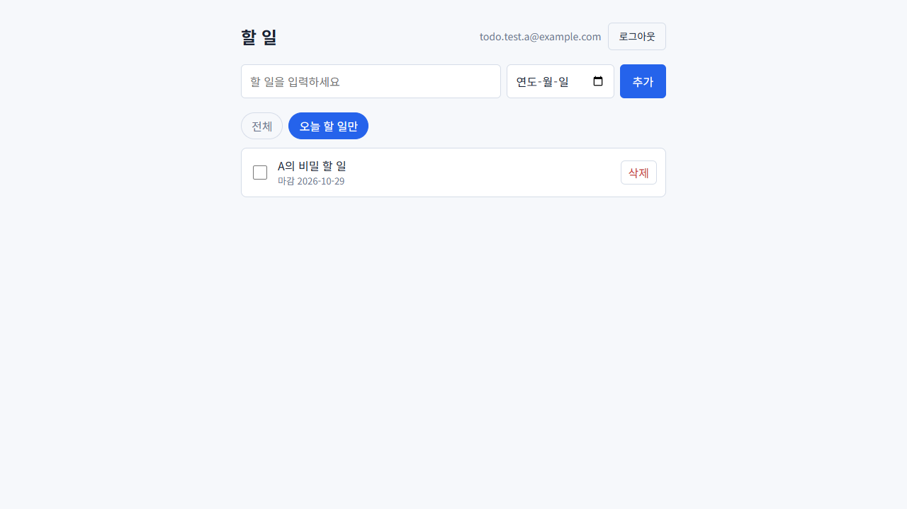
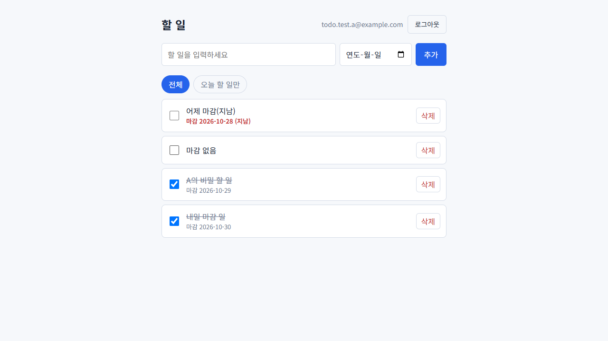
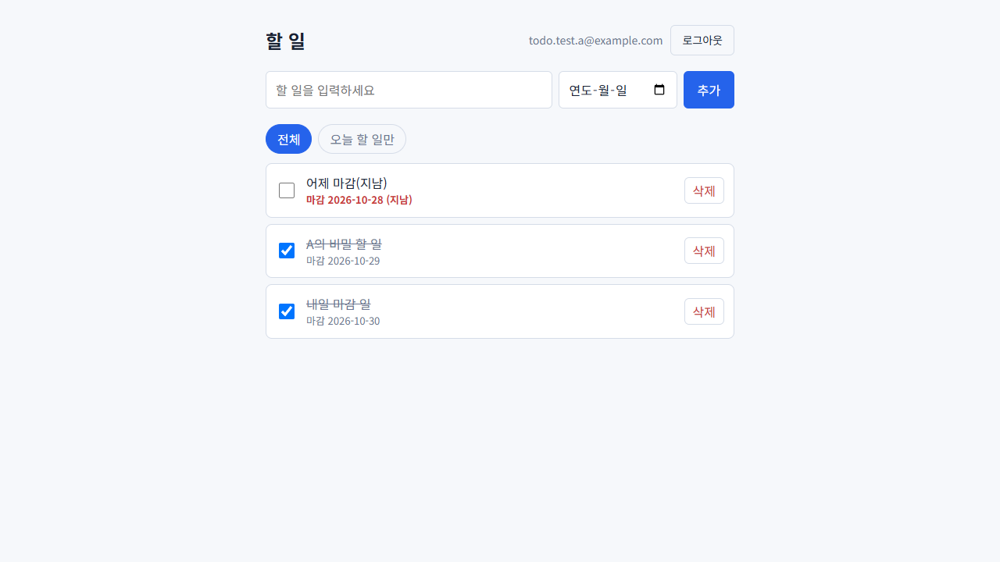
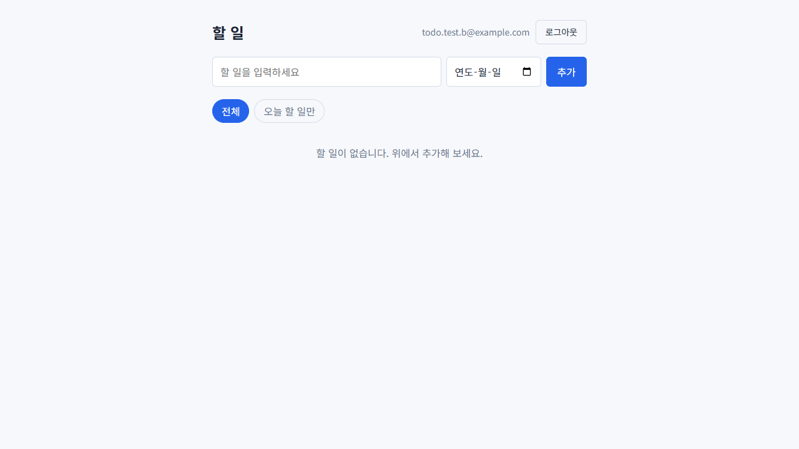

# Todo 앱 (Supabase)

로그인한 사용자가 자기 할 일만 관리하는 앱입니다. 데이터는 Supabase(Postgres)에 저장됩니다.

## 짝 퀘스트 회고
어려워보여서 솔직히 피하고싶었는데 막상하니 이해되고 편하다

## 제출 요약

| 항목 | 내용 |
|---|---|
| PRD | [PRD.md](PRD.md) (한 장) |
| 클라우드 전환 기록 | 길 A(로컬 SQLite `todo.db`)에서 길 B(Supabase Postgres + Supabase Auth)로 전환했다. 화면은 백엔드 `/api`에만 요청하고 키는 백엔드 `.env`에서만 쓴다. |
| RLS 확인 기록 | `todo` 표에 RLS를 켜고 계정 2개로 확인했다. B는 A의 할 일이 보이지 않고, 수정·삭제는 0건이며, A의 `user_id`로 위조해 추가하면 `row-level security policy` 위반(403)으로 거부되고, 로그인 없는 접근은 401이다. |
| 상세 기록 | [SUBMISSION.md](SUBMISSION.md) |
| 배포 URL | https://todo-app-iw2l.onrender.com |

### 작동 화면

**로컬(SQLite)**: 추가·완료·삭제 동작, 서버를 껐다 켜도 데이터 유지 (로그인 기능을 넣기 전 버전)



**클라우드(Supabase)**

| 로그인 화면 | 할 일 목록 |
|---|---|
|  |  |

| 오늘 할 일만 보기 | 완료 체크 |
|---|---|
|  |  |

| 삭제 후 | 서버를 껐다 켠 뒤에도 데이터 유지 |
|---|---|
|  |  |

**RLS 확인**: 다른 계정(B)으로 로그인하면 A의 할 일이 보이지 않는다.



## 기능
- 회원가입 / 로그인 / 로그아웃 (Supabase Auth)
- 할 일 추가 / 목록 / 완료 표시 / 삭제 (내 것만)
- 마감일 표시, 오늘 할 일만 보기

## 구조
```
브라우저(static/) ──/api──▶ Flask 백엔드(app.py) ──REST──▶ Supabase (Auth + Postgres, RLS)
```
- 화면 코드는 백엔드 `/api/...`에만 요청합니다. Supabase 주소·키는 화면에 없습니다.
- 로그인 토큰은 백엔드가 `httpOnly` 쿠키로 보관해서 화면 JS는 토큰을 볼 수 없습니다.
- 백엔드는 로그인한 사용자의 토큰으로 DB를 호출하므로 RLS가 실제로 적용됩니다.
  (RLS를 우회하는 `service_role` 키는 사용하지 않습니다.)

## Supabase 준비 (처음 한 번)
1. https://supabase.com 에서 무료 프로젝트를 만듭니다.
2. **SQL Editor**에 `supabase_schema.sql` 내용을 붙여 넣고 실행합니다. (표, RLS, 정책 생성)
3. **Project Settings > API**에서 `Project URL`과 `anon`(또는 publishable) 키를 복사합니다.
4. 가입 시 이메일 인증 메일을 쓰지 않으려면 **Authentication > Sign In / Providers > Email**에서 `Confirm email`을 끕니다. (켜 두면 가입 후 메일 링크를 눌러야 로그인됩니다.)

## 실행
```
cd Todo
python -m pip install -r requirements.txt
copy .env.example .env      # 열어서 SUPABASE_URL, SUPABASE_ANON_KEY 입력
python app.py
```
http://localhost:5000 을 엽니다.

## 설정 (`.env`)
| 이름 | 설명 |
|---|---|
| `SUPABASE_URL` | 프로젝트 URL |
| `SUPABASE_ANON_KEY` | anon/publishable 키 (service_role 키는 넣지 않습니다) |
| `PORT` | 로컬 서버 포트 (기본 5000) |
| `COOKIE_SECURE` | https 배포에서는 `true`, 로컬에서는 `false` |
| `APP_TIMEZONE` | "오늘" 기준 시간대 (기본 `Asia/Seoul`) |

`.env`는 `.gitignore`에 들어 있어 git에 올라가지 않습니다.

## API
| 기능 | 요청 |
|---|---|
| 회원가입 / 로그인 / 로그아웃 | `POST /api/auth/signup`, `/api/auth/login`, `/api/auth/logout` |
| 내 정보 | `GET /api/me` |
| 목록 / 오늘만 | `GET /api/todos`, `GET /api/todos?filter=today` |
| 추가 | `POST /api/todos` `{"title": "...", "due_date": "2026-10-29"}` |
| 완료/해제 | `PATCH /api/todos/<id>` `{"is_done": true}` |
| 삭제 | `DELETE /api/todos/<id>` |

로그인하지 않으면 `401`, 잘못된 입력은 `400`과 `{"error": "..."}`를 돌려줍니다.

## 예전 SQLite 버전
`legacy-sqlite/`에 보관되어 있습니다. (현재 앱에서는 사용하지 않습니다.)
